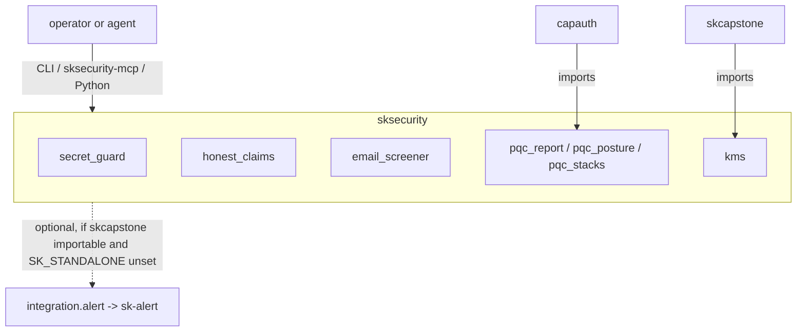

# SKSecurity - Standard Operating Procedures

`sksecurity` is a small Python package (CLI + stdio MCP server + libraries) for the
SKWorld agent estate. It ships four tools and one library:

- `guard`: credential leak detection (12 regexes) with a git pre-commit hook.
- `claims`: the honest-claims gate that blocks forbidden crypto overclaims. Runs in CI.
- `screen`: shallow text heuristics for phishing, prompt injection and social engineering.
- `pqc-*`: the post-quantum self-report (per surface: KEM, signature, cipher, hybrid or classical).
- `kms.py`: HKDF + AES-GCM key-wrapping KMS, imported by `skcapstone`.

It is read-only against the files it inspects, runs nothing in the background,
registers nothing with any scheduler, and makes no network calls.

**Maturity tier: T0 (symmetric/hash only).** Its own crypto is scrypt, HKDF-SHA256 and
AES-256-GCM, all symmetric/hash, so there is no Shor-vulnerable surface in this package.
A PGP master root wired into the KMS would add one and would then need a hybrid or
SLH-DSA root. Inventory and design: [docs/QUANTUM_RESISTANCE.md](docs/QUANTUM_RESISTANCE.md).

**CRYPTOGRAPHY_STANDARD:** this repo enforces the sk-standards
[CRYPTOGRAPHY_STANDARD](https://github.com/smilinTux/sk-standards) through the claims
gate and the `pqc-*` self-report (FIPS 203/204/205, RFC 5869, RFC 7914, SP 800-38D).
It hand-rolls no primitives. License: GPL-3.0-or-later. Python 3.9 or newer.

## 1. Overview

What it does not do: scan code for vulnerabilities, quarantine anything, monitor
processes, fetch threat intelligence, serve a dashboard, or run on a schedule. Version
1.x claimed those; 2.0 removed them (see [CHANGELOG.md](CHANGELOG.md)). Dependency CVEs,
filesystem secret sweeps and mail attachment scanning are planned separately and are
not part of this package yet.

Consumers outside this repo: `skcapstone` imports `sksecurity.kms` and reads
`sksecurity.__version__`; `capauth` imports `sksecurity.pqc_report`; CI runs
`sksecurity claims scan .`.

## 2. Architecture

Module map and consumer table: [docs/ARCHITECTURE.md](docs/ARCHITECTURE.md).



## 3. Build

```bash
python3 -m venv .venv
.venv/bin/pip install -e ".[dev]"
python -m pip install --upgrade build && python -m build
```

Never install the operational CLI or MCP server into the shared SK stack environment.
On a sovereign node, install or refresh the owned runtime with:

```bash
scripts/install-runtime.sh
~/.venvs/sksecurity/bin/python -m pip check
readlink -f ~/.local/bin/sksecurity
```

The installer owns `~/.venvs/sksecurity`, installs the `skcapstone` extra, and links
only the CLI and MCP entry points into `~/.local/bin`. Override with `SKSECURITY_VENV`,
`SKSECURITY_PYTHON` or `SKSECURITY_REPO`.

## 4. Test

```bash
HOME=$(mktemp -d) SKCAPSTONE_HOME=$(mktemp -d) SK_STANDALONE=1 pytest -q
ruff check sksecurity/
```

Always run tests with a throwaway `HOME`. `tests/conftest.py` forces this for you, but
set it anyway: an earlier version of the suite ran against the real `HOME` and
rewrote `~/.skcapstone/registry/sksecurity.json`. `tests/test_isolation.py` guards the
isolation.

| Suite | Covers |
|---|---|
| `test_cli.py` | kept commands work, removed commands stay removed, nothing is moved |
| `test_secret_guard.py` | patterns, staged scan, test-context false-positive reduction |
| `test_email_screener.py` | verdicts, prompt-injection and phishing rules |
| `test_honest_claims.py` | the gate, plus a scan of this repo itself |
| `test_kms.py` | key hierarchy, AES-GCM wrap, scrypt seal, HKDF, rotation, audit log |
| `test_pqc_*.py`, `test_ratchet_report.py` | the PQC self-report |
| `test_mcp_server.py` | the two MCP tools |
| `test_integration_adapter.py`, `test_isolation.py` | sk-alert adapter, test isolation |

## 5. Release / Deploy

The git tag is the version. `pyproject.toml` declares `dynamic = ["version"]` and has no
`version =` field; setuptools-scm derives it from the tag and writes
`sksecurity/_version.py` at build time (gitignored). Flow: update `CHANGELOG.md`, run the
test gate, `git tag vX.Y.Z`, push the tag, and `.github/workflows/publish.yml` publishes
to PyPI.

Do not reintroduce a hardcoded `version`. Tags v1.2.2 to v1.2.4 were cut without bumping
the literal, so each rebuilt 1.2.1 and PyPI rejected the duplicate. The evidence block at
the end of this file fails if a static `version` field reappears.

2.0.0 is a breaking release (CLI commands removed). Check `skcapstone` and `capauth`
still import cleanly before tagging: `python -c "import sksecurity.kms, sksecurity.pqc_report"`.

### Legacy units on sovereign nodes (not part of this repo)

A node may still carry `sksecurity-audit.service` and `.timer`, and a skcapstone
scheduler drop-in `jobs.d/sksecurity_intel_refresh.yaml` that runs
`sksecurity update --sources all`. That command no longer exists, so the drop-in will
keep failing until it is removed. Removing either is a fleet change that needs Chef's
approval. This repo ships no unit and registers no job.

### Exposure

Tier 0, no public route, no listener. The CLI is a one-shot process and the MCP server
speaks stdio. Importing the package binds nothing. (The Flask dashboard that 1.x carried,
which had no authentication, was deleted.)

## 6. Configuration

There is no config file and no data directory, except the KMS, which stores keys under
`~/.sksecurity/kms/keys` and its audit log at `~/.sksecurity/kms/audit.log` by default.

| Knob | Effect |
|---|---|
| `SK_STANDALONE=1` | disable the skcapstone sk-alert adapter (log locally instead) |
| `SKSTACKS_ROOT` | where `pqc-stacks` looks for SKStacks v2 descriptors (default `~/clawd/SKStacks`) |
| `.honestclaims-allow` | globs of files the claims gate skips |
| `# honest-claims: allow` | per-line suppression |

Never inline a live secret. Run `sksecurity guard staged` before a commit, or install the
hook with `sksecurity guard install`.

## 7. Reference

CLI (`sksecurity`):

| Group | Commands |
|---|---|
| secret guard | `guard scan`, `guard staged`, `guard install`, `guard text` |
| honest claims | `claims scan`, `claims text` |
| screening | `screen` |
| PQC | `pqc-report`, `pqc-posture`, `pqc-dashboard`, `pqc-snapshot`, `pqc-stacks` |

MCP tools (`sksecurity-mcp`, stdio): `check_secrets`, `screen_input`.

Python: `sksecurity.secret_guard`, `sksecurity.email_screener`, `sksecurity.honest_claims`,
`sksecurity.kms`, `sksecurity.pqc_report`, `sksecurity.integration`.

## 8. Troubleshooting

| Symptom | Likely cause | Fix |
|---|---|---|
| `sksecurity: No such command 'scan'` (or audit, status, update, monitor, dashboard, quarantine, init) | removed in 2.0 | use `guard scan` for secrets; see CHANGELOG |
| `--ai`, `--config` not recognised | removed in 2.0 | drop the option |
| guard flags a test fixture | false positive in test context | confirm it is a fixture; refine the pattern rather than disabling it |
| `screen` says SAFE for something bad | the screener is shallow, text-only | do not rely on it alone |
| claims gate flags your docs | forbidden crypto word | say "post-quantum" or "quantum-resistant", cite the FIPS number and hybrid-vs-classical |
| `pqc-stacks`: no SKStacks v2 descriptors | SKStacks not at `~/clawd/SKStacks` | set `SKSTACKS_ROOT` |
| MCP client sees no tools | server not launched | run `sksecurity-mcp`, add it to the client's `mcpServers` |
| a test run hangs on `import oqs` | liboqs missing from the (fake) HOME, so it tries to build it | link or install liboqs into the test HOME (`tests/conftest.py` links `~/_oqs` if present) |
| `sksecurity_intel_refresh` job fails daily | stale skcapstone drop-in calls the removed `update` command | remove the drop-in (fleet change, needs approval) |

## 9. Maturity and version

- Maturity tier: T0, symmetric/hash only (see the top of this file).
- VERSION_LIFECYCLE phase: active, 2.0 (unreleased). The version is not written down
  here on purpose. Read it from `git describe --tags --abbrev=0` or from an install
  (`python -c "import sksecurity; print(sksecurity.__version__)"`).
- PQC role: epic `PQC-MIGRATION` (coord `e1d6ba2a`). SKSecurity is the evidence engine;
  the master plan is skchat `docs/quantum-resistance-architecture.md`.

---

SK = staycuriousANDkeepsmilin

<!-- docs-evidence
verified: 2026-11-11
checks:
  - name: both console entry points still resolve as documented
    run: grep -qxF 'sksecurity = "sksecurity.cli:main"' pyproject.toml && grep -qxF 'sksecurity-mcp = "sksecurity.mcp_server:main"' pyproject.toml
  - name: version stays setuptools-scm derived, no hardcoded version field
    run: grep -qxF 'dynamic = ["version"]' pyproject.toml && ! grep -qE "^version *=" pyproject.toml
  - name: documented KMS key store and audit log paths match kms.py
    run: grep -qF 'Path("~/.sksecurity/kms/keys")' sksecurity/kms.py && grep -qF 'Path("~/.sksecurity/kms/audit.log")' sksecurity/kms.py
  - name: the removed SOC modules are still gone
    run: test ! -e sksecurity/scanner.py && test ! -e sksecurity/quarantine.py && test ! -e sksecurity/dashboard.py && test ! -e sksecurity/monitor.py && test ! -e sksecurity/database.py
  - name: the integration adapter still has no registry or scheduler writers
    run: ! grep -qE "def (register_self|ensure_schedule|unregister_schedule)" sksecurity/integration.py
  - name: the CLI exposes only the documented command groups
    run: grep -qxF "@claims.command(name='scan')" sksecurity/cli.py && grep -qxF "@guard.command(name='scan')" sksecurity/cli.py && ! grep -qE "^def (scan|audit|quarantine|status|update|monitor|dashboard|init)\(" sksecurity/cli.py
  - name: the MCP server exposes exactly the two documented tools
    run: grep -qF 'name="screen_input"' sksecurity/mcp_server.py && grep -qF 'name="check_secrets"' sksecurity/mcp_server.py && ! grep -qE 'name="(scan_path|get_events|monitor_status)"' sksecurity/mcp_server.py
  - name: honest-claims gate still runs the scanner and is not neutered by || true
    run: grep -qxF "        run: sksecurity claims scan ." .github/workflows/honest-claims.yml && ! grep -qF "|| true" .github/workflows/honest-claims.yml
  - name: the test suite isolates HOME and SK_STANDALONE
    run: grep -qF 'os.environ["SK_STANDALONE"] = "1"' tests/conftest.py && grep -qF 'monkeypatch.setenv("HOME"' tests/conftest.py
-->
